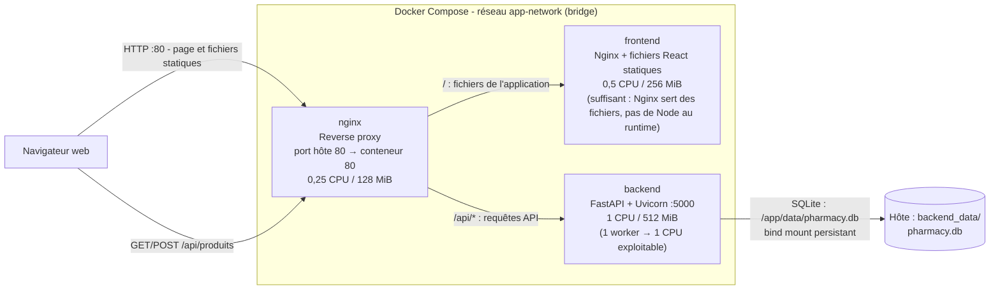

# Pharmacy — Application full-stack conteneurisée

Application de gestion de pharmacie composée de trois conteneurs orchestrés
par Docker Compose :

- un **reverse proxy Nginx** qui expose l'application sur le port 80 ;
- un **frontend React** compilé et servi par Nginx ;
- une **API FastAPI** (Uvicorn) adossée à une base **SQLite** persistée sur
  l'hôte.

---

## Sommaire

- [Architecture](#architecture)
- [Images, dépendances et commandes](#images-dépendances-et-commandes)
- [Réglage des ressources](#réglage-des-ressources)
- [Configuration avec .env](#configuration-avec-env)
- [Lancer les vérifications CI](#lancer-les-vérifications-ci)
- [Justification des limites de ressources](#justification-des-limites-de-ressources)
- [Démarrage rapide](#démarrage-rapide)
- [Benchmarks CPU et mémoire](#benchmarks-cpu-et-mémoire)
- [Ressources consultées](#ressources-consultées)

---

## Architecture



Le navigateur accède à l'application via le port 80 publié par Nginx. Nginx
sert les fichiers statiques du frontend et transmet les requêtes `/api/*` au
backend. La base SQLite du backend est conservée sur l'hôte dans
`backend_data/`.

### Images, dépendances et commandes

Les services applicatifs et CI sont construits depuis les Dockerfiles du dépôt.
Les images de base officielles servent de fondation ; les configurations et
contenus propres au projet sont ajoutés lors de la construction.

| Service | Image de base et personnalisation | Dépendances / opérations système | Commande et arrêt |
|---|---|---|---|
| `nginx` | `nginx:alpine`, configuration de reverse proxy copiée dans `/etc/nginx/conf.d/default.conf` à la place de la configuration par défaut | Aucune installation supplémentaire | `nginx -g "daemon off;"` reste au premier plan ; Nginx reçoit `SIGTERM` directement comme processus PID 1 et arrête proprement les workers. |
| `frontend` | Construction multi-étape : `node:22-alpine` construit React/Vite, puis les fichiers `dist/` sont copiés dans `nginx:alpine` | `npm install` installe les dépendances définies dans `frontend/package.json` ; aucune dépendance Node n'est présente dans l'image d'exécution | Nginx sert les fichiers statiques sur le port 80 et reçoit directement `SIGTERM` comme PID 1. |
| `backend` | `python:3.11-slim`, application FastAPI copiée dans `/app` | `apt-get` installe `curl` pour les diagnostics, puis `pip` installe `backend/requirements.txt` (FastAPI, Uvicorn, Pydantic) ; le cache APT est supprimé pour réduire l'image | `uvicorn app:app --host 0.0.0.0 --port 5000` ; Uvicorn reçoit directement `SIGTERM` comme PID 1 et gère l'arrêt gracieux. |
| `lint` (CI) | `node:22-bookworm`, outils Python et code frontend/backend copiés dans l'image | APT installe `python3` et `python3-venv`. Ruff `0.11.13` est installé dans l'environnement isolé `/opt/ruff`. `npm ci` installe depuis `frontend/package-lock.json` React, React DOM, ESLint et ses plugins, Vite, Tailwind CSS et son plugin Vite. | `ci/run-lint.sh` lance Ruff (`check` et vérification du formatage), ESLint puis le build Vite. Les sorties de chaque contrôle sont enregistrées dans `/reports/`. |
| `test` (CI) | `python:3.11-slim`, code backend et script de test copiés dans l'image | `pip` installe `backend/requirements-dev.txt` : FastAPI `0.110.0`, Uvicorn `0.28.0`, Pydantic `2.6.4` (via `requirements.txt`), ainsi que `httpx 0.27.2`, `pytest 8.3.5` et Ruff `0.11.13`. Ruff est installé dans cette image mais n'est pas exécuté par le script de tests. | `ci/run-tests.sh` lance `python -m pytest tests`, écrit la sortie dans `/reports/backend-tests.txt` et génère le rapport JUnit `/reports/backend-tests.xml`. |

Les ports déclarés par les images ne les publient pas à eux seuls sur l'hôte :
seul le port 80 du service `nginx` est publié par le Compose principal. Les
services frontend et backend sont accessibles aux autres conteneurs sur le
réseau privé `app-network`.

### Réglage des ressources

Chaque service dispose d'une limite CPU et mémoire dans Compose. Les valeurs
par défaut sont adaptées à une petite stack de démonstration ; elles peuvent
être remplacées par des variables d'environnement sans modifier les fichiers :

| Service | CPU par défaut | Mémoire par défaut | Variables Compose |
|---|---:|---:|---|
| `nginx` | 0,25 | 128 MiB | `NGINX_CPUS`, `NGINX_MEMORY` |
| `frontend` | 0,50 | 256 MiB | `FRONTEND_CPUS`, `FRONTEND_MEMORY` |
| `backend` | 1,0 | 512 MiB | `BACKEND_CPUS`, `BACKEND_MEMORY` |
| `lint` (CI) | 1,0 | 1 GiB | `CI_LINT_CPUS`, `CI_LINT_MEMORY` |
| `test` (CI) | 0,50 | 512 MiB | `CI_TEST_CPUS`, `CI_TEST_MEMORY` |

Exemple PowerShell pour démarrer avec une limite différente :

```powershell
$env:BACKEND_CPUS = "0.75"
$env:BACKEND_MEMORY = "768M"
docker compose up --build
```

Les valeurs sont des limites maximales, pas des ressources réservées. Elles
sont déclarées dans le fichier `.env` à la racine, chargé automatiquement par
Docker Compose.

### Configuration avec `.env`

Le fichier `.env` à la racine centralise le port HTTP publié, le chemin de
persistance SQLite et les limites CPU/mémoire des services applicatifs et CI.
Il est ignoré par Git pour éviter de publier une configuration locale ; le
fichier `.env.example`, qui contient les valeurs par défaut sans secret, est
versionné comme modèle. Après un clone, créez votre `.env` depuis ce modèle :

```powershell
Copy-Item .env.example .env
```

Modifiez ensuite les valeurs dans `.env`. Par exemple, `HTTP_PORT=8080`
publie l'application sur le port hôte 8080, tandis que `BACKEND_DATA_DIR`
permet de déplacer le dossier de données. Les réglages `CI_LINT_*` et
`CI_TEST_*` s'appliquent aux services du fichier `ci/compose.ci.yml`.

### Lancer les vérifications CI

```sh
docker compose -f ci/compose.ci.yml run --build --rm lint
docker compose -f ci/compose.ci.yml run --build --rm test
```

Les rapports sont écrits dans `ci/reports/` sur l'hôte. Les scripts exécutent
les contrôles séquentiellement et retournent un code d'échec si un contrôle
échoue.

---

## Justification des limites de ressources

Les plafonds donnent davantage de ressources au backend qu'au frontend, car
leurs rôles et leurs traitements diffèrent. Ce sont des **choix de départ pour
une stack de démonstration**, et non des besoins établis par des mesures de
charge de l'application.

- **Frontend — 0,5 CPU / 256 MiB.** Le conteneur exécute Nginx pour servir des
  fichiers statiques déjà construits ; il ne fait pas tourner React ni son
  processus de compilation. Une limite inférieure à celle du backend est donc
  cohérente avec son rôle de serveur de contenu statique, pour un trafic de
  démonstration.
- **Backend — 1 CPU / 512 MiB.** Le conteneur exécute Python, FastAPI, Uvicorn
  et accède à SQLite. Il reçoit donc un plafond supérieur à celui du frontend
  pour laisser plus de marge à l'exécution de l'API et à ses traitements. La
  commande `uvicorn app:app` démarre un seul worker ; le plafond d'un CPU est
  cohérent avec cette configuration simple, mais ne garantit pas à lui seul
  que la capacité ou la mémoire suffiront sous charge.
- **Nginx (reverse proxy) — 0,25 CPU / 128 MiB.** Nginx relaie les requêtes
  vers le frontend et le backend sans exécuter de logique applicative lourde.
  Ce plafond modeste est un point de départ pour la démonstration et reste
  réglable comme les autres limites.

Ces raisons justifient l'**ordre de grandeur relatif** des choix, pas leur
adéquation à une charge précise. Les benchmarks Sysbench de la section suivante
illustrent l'effet de limites CPU et mémoire sur des scénarios synthétiques ;
ils ne mesurent pas les besoins de cette application. Pour confirmer ou
ajuster les plafonds, il faudrait tester la stack avec des requêtes
représentatives et observer la consommation CPU et mémoire, les temps de
réponse et les erreurs.

---

## Démarrage rapide

### Prérequis

- Docker Engine 24+ et Docker Compose v2
- (Optionnel) Python 3.11 pour lancer le backend hors conteneur

### Lancer la stack

```sh
docker compose up --build
```

L'application est accessible sur <http://localhost>.

### Arrêter la stack

```sh
docker compose down
```

Les données SQLite restent dans `backend_data/` , elles survivent
donc à l'arrêt et au remplacement du conteneur backend.

### Structure du dépôt

```
.
├── nginx/            # Configuration du reverse proxy
├── frontend/         # Dockerfile React + fichiers statiques
├── backend/          # Dockerfile FastAPI + code applicatif
├── backend_data/     # Base SQLite persistée (bind mount)
├── benchmarks/       # Scripts et rapports de benchmark
```

---

## Benchmarks CPU et mémoire

Comparer les résultats avec les mêmes paramètres. Sans option de limite, le
conteneur utilise les ressources disponibles sur l'hôte.

### CPU

```sh
# Sans limite CPU
docker run --rm severalnines/sysbench sysbench cpu --threads=4 run

# Limité à 2 CPU
docker run --rm --cpus=2 severalnines/sysbench sysbench cpu --threads=4 run

# Limité à 0,5 CPU
docker run --rm --cpus=0.5 severalnines/sysbench sysbench cpu --threads=4 run
```

### Mémoire

Le test utilise un bloc mémoire de 128 MiB et parcourt 1 GiB de données.
Comparer les limites en conservant les mêmes paramètres :

```sh
# Sans limite mémoire
docker run --rm severalnines/sysbench sysbench memory \
  --threads=1 --memory-block-size=128M --memory-total-size=1G run

# Limité à 256 MiB (sans swap)
docker run --rm --memory=256m --memory-swap=256m severalnines/sysbench sysbench memory \
  --threads=1 --memory-block-size=128M --memory-total-size=1G run

# Limité à 512 MiB (sans swap)
docker run --rm --memory=512m --memory-swap=512m severalnines/sysbench sysbench memory \
  --threads=1 --memory-block-size=128M --memory-total-size=1G run
```

Sysbench affiche le débit et le temps d'exécution ; le runtime dépend aussi
de la machine hôte. Une limite mémoire trop basse peut entraîner l'arrêt du
conteneur par manque de mémoire (OOM).

### Lecture des résultats

- **CPU** : comparer le nombre d'événements par seconde entre les trois
  scénarios. Un effondrement avec `--cpus=0.5` signale un goulot
  d'étranglement CPU — à vérifier côté backend si Uvicorn sature.
- **Mémoire** : comparer le débit. Un conteneur tué par OOM (code de sortie
  `137`) signifie que la limite est trop basse pour la charge testée.

### Automatisation sous Windows

Lancer les six scénarios avec le fichier batch fourni :

```bat
benchmarks\resource-benchmark.bat
```

Le script affiche les résultats dans le terminal et crée
`benchmarks\resource-report.md` avec la date, la version de Docker, les
commandes, les sorties Sysbench et le statut de chaque scénario. Le rapport
est remplacé à chaque nouvelle exécution.

---

## Ressources consultées

- [Python package management with uv for Dockerized environments](https://medium.com/@shaliamekh/python-package-management-with-uv-for-dockerized-environments-f3d727795044)
- [FastAPI — créer les tables de la base de données au démarrage](https://fastapi.tiangolo.com/tutorial/sql-databases/#create-database-tables-on-startup)
- [Ajouter SQLite à une application FastAPI](https://timberry.dev/adding-an-sqlite-backend-to-fastapi)
- [Docker benchmark performance](https://oneuptime.com/blog/post/2026-01-16-docker-benchmark-performance/view)