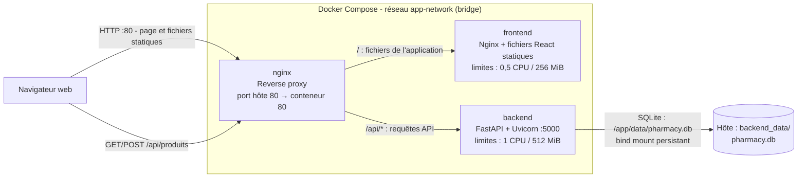

## Architecture



Le navigateur accède à l'application via le port 80 publié par Nginx. Nginx
sert les fichiers statiques du frontend et transmet les requêtes `/api/*` au
backend. La base SQLite du backend est conservée sur l'hôte dans
`backend_data/`.

## Benchmarks CPU et mémoire

Comparer les résultats avec les mêmes paramètres. Sans option de limite, le
conteneur utilise les ressources disponibles sur l'hôte.

### CPU

```sh
# Sans limite CPU
docker run --rm severalnines/sysbench sysbench cpu --threads=4 run

# Limité à 2 CPU
docker run --rm --cpus=2 severalnines/sysbench sysbench cpu --threads=4 run

# Limité à 0,5 CPU
docker run --rm --cpus=0.5 severalnines/sysbench sysbench cpu --threads=4 run
```

### Mémoire

Le test utilise un bloc mémoire de 128 MiB et parcourt 1 GiB de données.
Comparer les limites en conservant les mêmes paramètres :

```sh
# Sans limite mémoire
docker run --rm severalnines/sysbench sysbench memory \
  --threads=1 --memory-block-size=128M --memory-total-size=1G run

# Limité à 256 MiB (sans swap)
docker run --rm --memory=256m --memory-swap=256m severalnines/sysbench sysbench memory \
  --threads=1 --memory-block-size=128M --memory-total-size=1G run

# Limité à 512 MiB (sans swap)
docker run --rm --memory=512m --memory-swap=512m severalnines/sysbench sysbench memory \
  --threads=1 --memory-block-size=128M --memory-total-size=1G run
```

Sysbench affiche le débit et le temps d'exécution ; le runtime dépend aussi
de la machine hôte. Une limite mémoire trop basse peut entraîner l'arrêt du
conteneur par manque de mémoire (OOM).

Sous Windows, lance les six scénarios avec le fichier batch fourni :

```bat
benchmarks\resource-benchmark.bat
```

Le script affiche les résultats dans le terminal et crée
`benchmarks\resource-report.md` avec la date, la version de Docker, les
commandes, les sorties Sysbench et le statut de chaque scénario. Le rapport
est remplacé à chaque nouvelle exécution.

## Ressources consultées

- [Python package management with uv for Dockerized environments](https://medium.com/@shaliamekh/python-package-management-with-uv-for-dockerized-environments-f3d727795044)
- [FastAPI — créer les tables de la base de données au démarrage](https://fastapi.tiangolo.com/tutorial/sql-databases/#create-database-tables-on-startup)
- [Ajouter SQLite à une application FastAPI](https://timberry.dev/adding-an-sqlite-backend-to-fastapi)
- [Docker benchmark performance](https://oneuptime.com/blog/post/2026-01-16-docker-benchmark-performance/view)